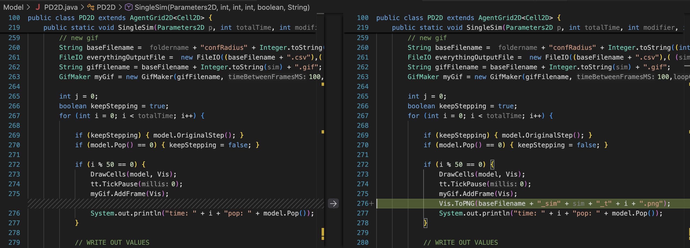

## Integration of AI with Agent-Based Modeling of Multicellular Systems: Current and Emerging Landscape

This document describes the configuration and execution of the simulations shown in Figure 2b of the review. The following entries summarize the model sources, setup instructions, and the specific output files used to generate the figure panels.

- Cellular Automata — spatially structured tumor clonal evolution (HAL)
    - Model: extracted from [10.1038/s41467-021-22123-1](https://doi.org/10.1038/s41467-021-22123-1)
    - Repository: https://github.com/MathOnco/tissue-structure-modulates-evolution
    - Setup: follow the repository README for installation and dependencies.
    - Snapshot export: add the following line to `Model/PD2D.java` to save PNG snapshots:
        ```java
        Vis.ToPNG(baseFilename + "_sim" + sim + "_t" + i + ".png");
        ```
      This is illustrated in the figure below.
      
    - Execution: run the model using the included script `HAL_run_PD2D.sh` and extract the file `data-output/confRadius100br50dr50sp100_sd10000_Tp5000000_Td700_sim0_t950.png` for the figure.
- Cellular Potts — pluripotent stem-cell self-organization (Morpheus)
    - Model: extracted from [10.1016/j.cels.2019.10.008](https://doi.org/10.1016/j.cels.2019.10.008)
    - Repository: https://morpheus.gitlab.io/model/m7672/
    - Software: download Morpheus from https://morpheus.gitlab.io/#download.
    - Usage: open the model using the morpheus:// URL (for example `morpheus://morpheus.gitlab.io/media/model/m7672/model.xml`) or download the XML and load it in the Morpheus GUI. Run the simulation and extract `plot_00080.png` for the figure.
- Center-based — pancreatic cancer invasion mediated by fibroblast–ECM interactions (PhysiCell)
    - Model: extracted from [10.1016/j.cell.2025.06.048](https://doi.org/10.1016/j.cell.2025.06.048)
    - Repository: https://github.com/PhysiCell-Models/grammar_samples
    - Setup and run: follow the repository README, set the initial condition to `PDAC02`, then execute:
        ```sh
        make load PROJ=epi_caf_invasion && make && ./project ./config/PhysiCell_settings_PDAC.xml
        ```
    - Extract the snapshot file `outputs/epi_caf_invasion_PDAC02/snapshot00000015.svg` for the figure.
- Boundary-based — growing epithelial monolayer (PolyHoop)
    - Model: extracted from [10.1016/j.cpc.2024.109128](https://doi.org/10.1016/j.cpc.2024.109128)
    - Data: https://data.mendeley.com/datasets/4jscxhkd2s/1
    - Compile (per repository README):
        ```bash
        g++ -fopenmp -O3 -o polyhoop polyhoop.cpp
        ```
    - Run:
        ```bash
        ./polyhoop
        ```
    - Visualization: the model produces VTP snapshots. Use the provided Python script `PolyHoop_visualize_vtp.py` to convert or visualize VTP frames.
    - Extract the frame `output_frames/frame_0100.png` for the figure.
